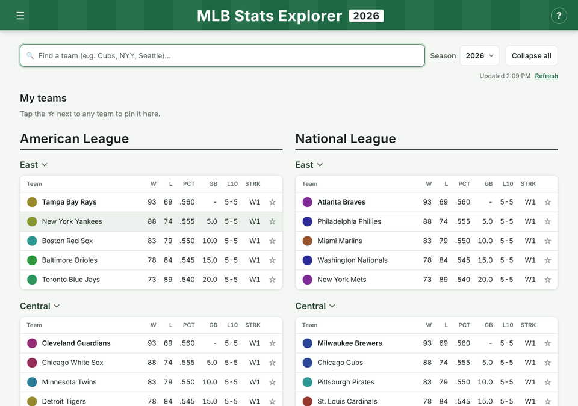
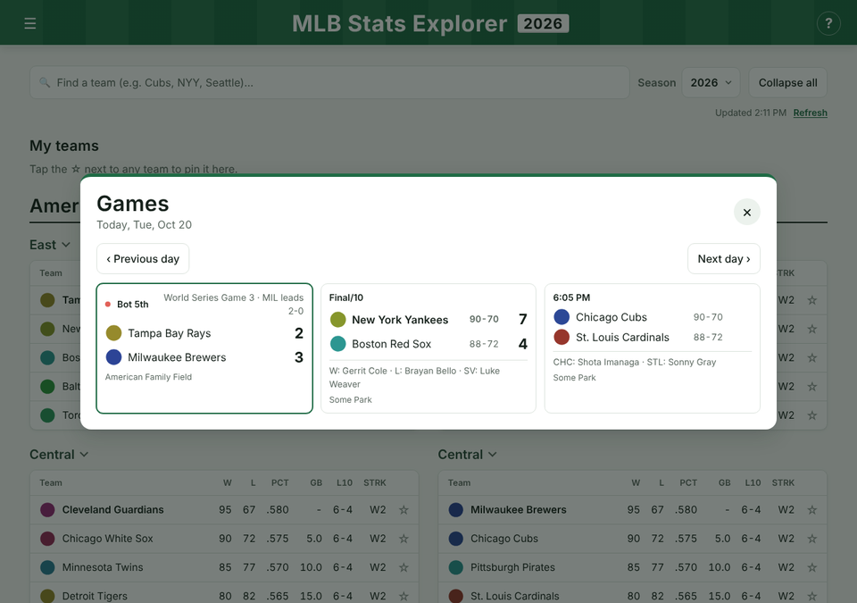
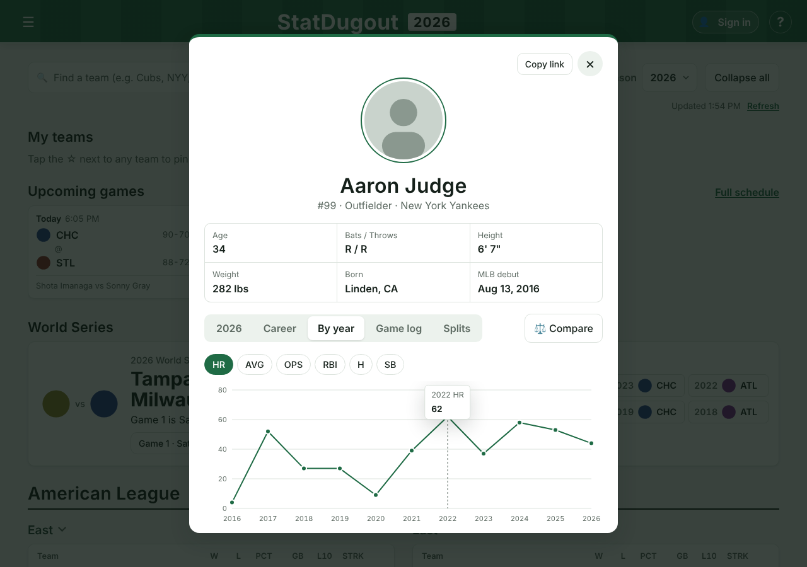
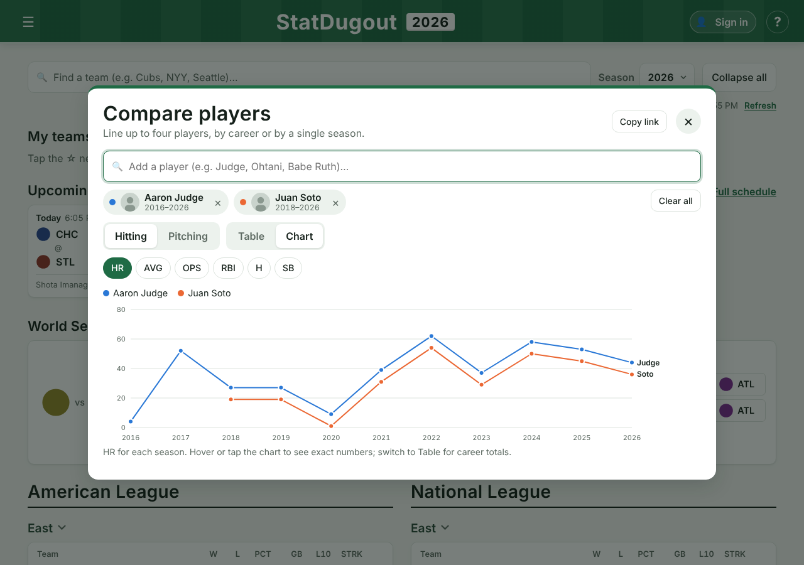

# ⚾ MLB Stats Explorer

A fast, mobile-friendly web app for following Major League Baseball: standings, rosters, live scores, league leaders, player careers and side-by-side player comparisons, for any season back to 1969.

**Live site:** _add your Render URL here_



## Features

- **Standings for any season:** American and National League side by side, with W-L, PCT, games back, last 10 and streak. Pick any year from 1969 to today. Older seasons show the divisions that existed then.
- **Team pages:** the full roster with sortable hitting and pitching stats, a Games tab with recent results and upcoming games, and a Postseason tab with every playoff run since 1969 (each series, who they beat, and titles and pennants).
- **Upcoming games:** the next games on the home page, with times and probable pitchers, and your favorite teams marked.
- **World Series:** this year's matchup and series score, or the champion and series MVP for any past season, plus the last 10 champions. Click a year to jump to that season.
- **Player pages:** bio, season stats, career totals, a year-by-year table with an interactive chart, the last 15 games and splits (home/away, day/night, vs. lefties/righties).
- **Today's games:** live scores that refresh themselves, final scores with winning and losing pitchers, and probable pitchers for upcoming games. On days with no games it jumps you to the nearest game day.
- **League leaders:** the top 10 in HR, AVG, RBI, OPS, ERA, strikeouts, WHIP and more, for MLB, the AL or the NL, in any season.
- **Find a player:** search every MLB player, past or present.
- **Compare players:** up to four players by career or a single season, as a table (best value highlighted) or a year-by-year chart.
- **Shareable links:** every team, player and comparison has a Copy link button (for example `?player=592450&season=2024`).
- **Accounts:** sign in with a username and password or with Google, and your favorite teams are saved to your account and follow you to any device.
- **Favorites and themes:** star teams to pin them to the top. Pick a theme, including your favorite team's colors, which are automatically adjusted to stay readable.
- **Installable:** works as an app on your phone or desktop, and shows the last data you loaded when you're offline.
- **Accessible:** keyboard navigation (`/` to search, `Esc` to close), screen-reader labels, readable contrast in every theme, and it respects reduced-motion settings.

| Today's games | Player career chart | Compare players |
|---|---|---|
|  |  |  |

_Screenshots use sample data from the test suite._

## How it works

```
Browser (this repo: HTML + CSS + vanilla JS)
   │
   ├── Team list ───────────► Java backend on Render  (/api/teams)
   │                             └─ falls back to the MLB API if the backend is asleep
   ├── Sign-in, favorites ──► Java backend  (/api/auth/*, /api/me, /api/favorites)
   │                             └─ stored in Postgres on Neon
   │
   └── Everything else ─────► MLB Stats API (statsapi.mlb.com)
                                 standings · rosters · schedule · leaders · people · stats
```

- **No framework, no build step.** Plain HTML, CSS and JavaScript, served as static files.
- **Few requests.** A whole roster with every player's stats loads in one request using the API's `hydrate` option, instead of one request per player.
- **Handles a sleeping backend.** Free Render services sleep when idle. The app shows a "waking up" message and switches to the MLB API directly if the backend doesn't answer.
- **Readable team colors.** Team themes run through a WCAG contrast check (4.5:1) and are lightened or darkened until text is readable.
- **Offline-friendly.** A service worker (`sw.js`) uses network-first caching, so you get fresh data when online and the last data you saw when offline.

### Project layout

```
index.html              the page and all of its windows
js/app.js               starts everything (the only script the page loads)
js/api.js               every request to the MLB API and the Render backend
js/…                    one module per feature (see below)
css/…                   one stylesheet per part of the page
sw.js, manifest.webmanifest, icons/   install-as-an-app support
tests/                  browser tests (Playwright)
docs/                   README screenshots
favorites.html          old link; forwards to "My teams" on the home page
```

The JavaScript uses native ES modules: each file imports exactly what it uses, so there are no hidden globals and no build step.

| Module | What it does |
|---|---|
| `app.js` | Sets up every feature in order, loads data, and handles shared links |
| `api.js` | Config, the fetch helper, image URLs and every API request (one place to change data sources) |
| `state.js` | Shared state: season, teams, standings and caches |
| `util.js` | Small helpers: escaping, saved settings, toasts, dates |
| `theme.js` | Color themes, team colors and the readability (contrast) check |
| `standings.js` | Standings tables, My teams, season picker, Refresh |
| `search.js` | Team search and opening/closing divisions |
| `menu.js`, `modals.js` | The ☰ menu, and shared window behavior (Esc, focus, stacking) |
| `team.js`, `team-postseason.js` | Team window: roster, Games tab, Postseason tab |
| `player.js`, `career.js`, `find-player.js` | Player window (all tabs), career data, player search |
| `compare.js`, `charts.js` | Compare players, and the line charts |
| `games.js`, `leaders.js` | Today's games and League leaders |
| `upcoming.js`, `world-series.js` | Home-page Upcoming games and World Series sections |
| `share.js`, `pwa.js` | Copy-link buttons and install-as-an-app |
| `account.js` | Sign in (username or Google), and saving favorite teams to the account |

Stylesheets load in this order: `base.css` (colors, fonts, light/dark tokens), `layout.css`, `home.css`, `windows.css`, then one file per window (`team`, `player`, `compare`, `games`, `leaders`, `find-player`), `charts.css` and `account.css`.

## Running it locally

It's a static site, so any local web server works:

```bash
# from the project folder
python -m http.server 8000
# then open http://localhost:8000
```

## Tests

The `tests/` folder has browser tests that drive the real page in headless Chromium. Every MLB API call is mocked with realistic data, so the tests are fast, run offline and never fail because of real-world data. They cover standings, search, favorites, themes, sorting, keyboard use, season switching, career stats, traded players, compare, today's games, leaders, player search, game logs, splits, charts, share links, the backend-down fallback and phone layouts.

```bash
cd tests
npm install
npx playwright install chromium
npm test
```

GitHub Actions runs the same tests on every push and pull request (`.github/workflows/tests.yml`) and saves screenshots of each screen as a build artifact.

## Data

All baseball data comes from the public [MLB Stats API](https://statsapi.mlb.com). Team logos and player photos are served by MLB. This is a personal project and isn't affiliated with Major League Baseball.

---

Built by Zachary Sheppard.
